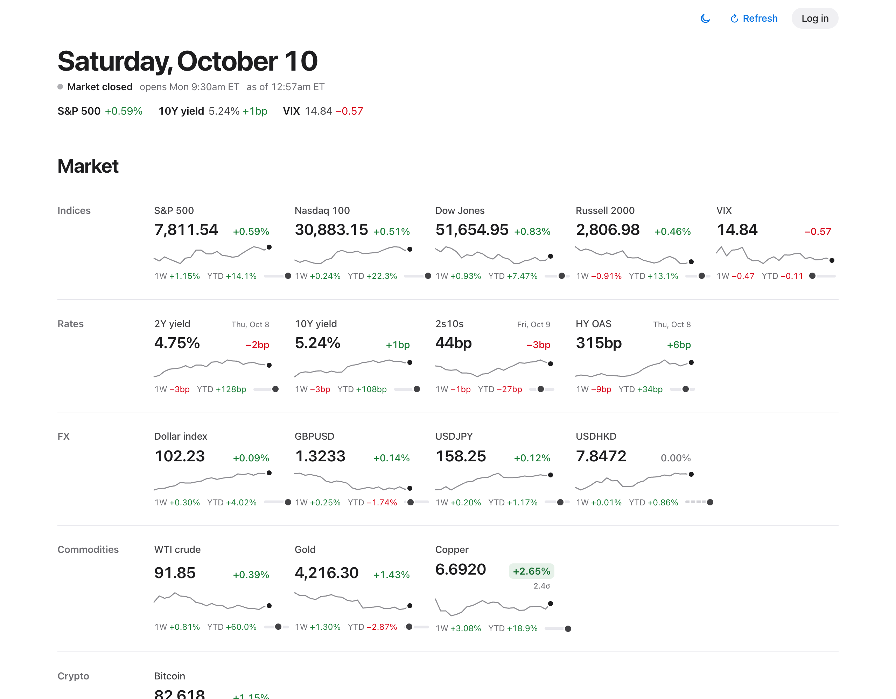
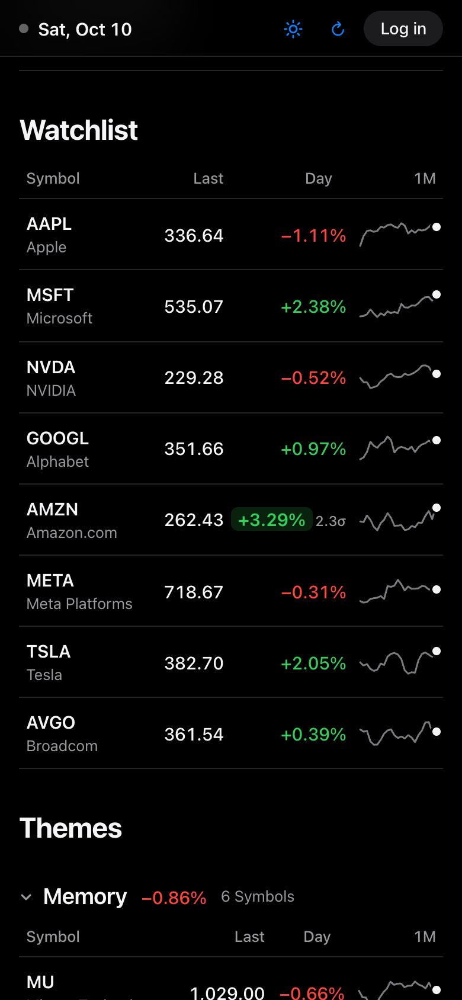
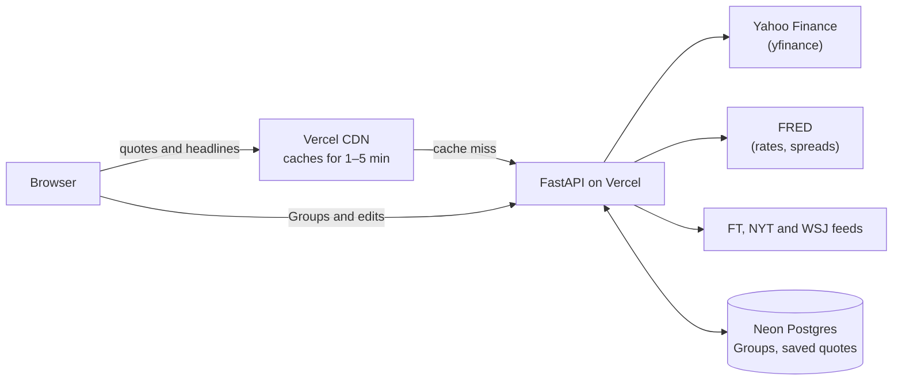

# Market Dashboard

A personal dashboard for catching up on the market once a day: how the whole market did, the companies
I follow, the themes I'm watching right now, and the news that matters. It isn't built for intraday
trading. It's built so that one glance answers "what happened today?"

**Live:** https://market-dashboard-nine-zeta.vercel.app (anyone can look; editing needs a password)

  
  

## What's on the page

The page reads top to bottom, from the whole market down to individual companies.

- **Market:** indices, VIX, Treasury yields and spreads, the dollar and major currencies, commodities
  and Bitcoin. Each tile shows the level, the day's move, a one-month sparkline, the 1-week and
  year-to-date change, and where it sits in its 52-week range.
- **Headlines:** the 15 newest market stories from the FT, the New York Times and the Wall Street
  Journal, merged when two outlets cover the same story.
- **Watchlist:** the companies I always follow, as a sortable table.
- **Themes:** baskets I put together because they matter right now (for example "Memory" or
  "Data Center"), each with a note on why and the basket's average move today.

A few details make the numbers easier to read:

- **Unusual moves stand out.** A day move of 2σ or more is shaded, where σ is the typical size of that
  Symbol's last 20 daily moves. A 3% day is noise for some stocks and news for others.
- **Each kind of number moves in its own unit.** Yields and spreads move in basis points, VIX in
  points, and the Hong Kong dollar is drawn against its 7.75–7.85 peg band instead of a 52-week range.
- **The page says when it's working from old data.** Outside market hours it says when the market
  opens next. If a price can't be refreshed, the banner names that Symbol, highlights it, and links to
  it.
- **Tap anything for details:** the 52-week range, distance from the high, the typical daily move, and
  the time of the last trade.

The page works on a phone as well as a desktop, and has light and dark modes that follow your system
or a toggle.

## How it works

- **One small backend, one static page.** A FastAPI app runs as a serverless function on Vercel. The
  page is plain HTML, CSS and JavaScript with no framework or build step.
- **Prices from free sources.** Yahoo Finance (through the open-source yfinance library) covers stocks,
  indices, futures, FX, crypto and Korean listings. FRED, the St. Louis Fed's data service, supplies
  the Treasury yields and credit spreads Yahoo doesn't have.
- **The database stays off the hot path.** The page asks for exactly the Symbols it shows, so the
  request URL itself identifies the data. Vercel's CDN can then answer most visitors from cache:
  every 60 seconds while the market is open and every 5 minutes when it's closed. The page also
  keeps the last data it saw, so it draws instantly on the next visit and then refreshes.
- **It degrades instead of breaking.** Good quotes are saved to Postgres. If Yahoo refuses a request,
  the page shows the saved price and marks it as old instead of showing a gap.
- **Headlines are merged and filtered.** Stories from different outlets are matched by URL or by
  near-identical titles and shown once with every source listed. Opinion columns and live-blog
  roundups are left out.
- **Market hours follow the NYSE calendar,** including holidays and early closes. That decides both the
  status at the top and how often the page refreshes.
- **Editing is behind one password.** Logging in turns on adding, removing and dragging Symbols, and
  creating, renaming and deleting Themes. The session is a signed, HTTP-only cookie.

**Built with:** Python 3.12, FastAPI, yfinance, psycopg, Neon Postgres, Vercel, vanilla JavaScript and
SortableJS for drag-and-drop.

## Running it yourself

[DEVELOPMENT.md](DEVELOPMENT.md) covers running it locally, the tests, deploying, and setting up your
own copy. [docs/adr](docs/adr) records why it's hosted the way it is.
